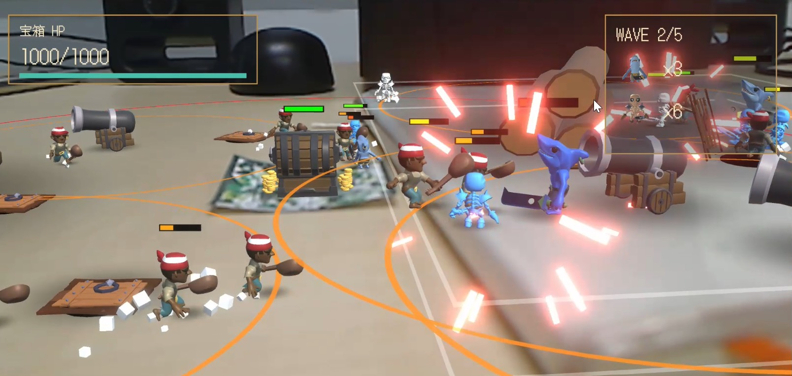

# AR Tower Defense

文房具を使って机の上に防衛陣地を作る、Unity / Vuforia製のARタワーディフェンスゲームです。
カメラでマーカーを認識し、大砲・壁・兵士の出現地点を配置して、敵のウェーブから宝箱を守ります。



## ゲームの仕組み

| 文房具 | ゲーム内の役割 | データベース / ターゲット名 |
| --- | --- | --- |
| ボールペン | 大砲。敵を自動で狙って砲撃 | `pen_A` / `marker_a` |
| 鉛筆 | 壁。敵の進行を妨げる | `pencil_B` / `marker_b` |
| 筆箱 | 宝箱。防衛対象と盤面の基準 | `pencase_C` / `marker_c` |
| 消しゴム | 兵士の出現地点。味方を送り出す | `eraser_D` / `marker_d` |

配置にはコストがかかります。配置フェーズで陣地を整え、戦闘を開始すると敵が出現します。
宝箱が破壊されるとゲームオーバー、全ウェーブの敵を倒すと勝利です。
盤面は筆箱のマーカーに追従し、見失うと一時停止します。本のマーカーを使った高台の配置にも対応しています。

## 開発環境

リポジトリに設定されているバージョンは以下のとおりです。

| 項目 | バージョン |
| --- | --- |
| Unity Editor | **6000.3.24f1** |
| Vuforia Engine | **11.4.4** |
| Universal Render Pipeline | **17.3.0** |
| Input System | **1.20.0** |

Unity Hub、Git、Git LFSを用意してください。エディターでカメラ入力を使って遊ぶには、Webカメラと対応するマーカー画像が必要です。

## セットアップ

### 1. リポジトリを取得する

```sh
git lfs install
git clone https://github.com/kaoruuy/ARTowerDefense.git
cd ARTowerDefense
git lfs pull
```

Vuforiaのパッケージと大容量モデルはGit LFSで管理しています。
`Packages/com.ptc.vuforia.engine-11.4.4.tgz` の実体を取得してからUnityで開いてください。
`Packages/manifest.json` はこのローカルパッケージを参照しています。

### 2. Unityで開く

1. Unity Hubにプロジェクトフォルダーを追加します。
2. Unity **6000.3.24f1** で開き、パッケージの解決とアセットのインポートが終わるまで待ちます。
3. [Assets/Scenes/ARgame.unity](Assets/Scenes/ARgame.unity) を開きます。

`Library/` などの生成ファイルはGitに含めていないため、初回起動時に再生成されます。

### 3. Vuforiaとカメラを設定する

1. 自分のVuforiaライセンスキーを用意し、Unityの **Vuforia Configuration** で設定します。
2. エディターで試す場合は、VuforiaのPlay Mode設定で使用するWebカメラを選びます。
3. 各ImageTargetに対応するマーカー画像を用意し、カメラに映します。

ライセンスキーを含む `Assets/Resources/VuforiaConfiguration.asset` とその `.meta` は共有対象から除外しています。クローンした環境ごとに設定してください。

マーカー画像は [Assets/Editor/Vuforia/ImageTargetTextures](Assets/Editor/Vuforia/ImageTargetTextures) に、認識用データベースは [Assets/StreamingAssets/Vuforia](Assets/StreamingAssets/Vuforia) にあります。
メインシーンの文房具マーカーには、上の表にある `pen_A`、`pencil_B`、`pencase_C`、`eraser_D` を使用します。

## 遊び方

1. `ARgame` シーンでUnityのPlayボタンを押します。
2. 筆箱のマーカーを認識させ、シャッターで宝箱を固定します。
3. 大砲・壁・兵士の出現地点を、残りコストに応じて配置します。位置を決めたらシャッターで固定します。
4. スタートを押して戦闘を開始します。戦闘中も筆箱のマーカーがカメラに映るようにしてください。
5. ゲーム終了後はリトライできます。

| 操作 | キーボード | 画面のボタン |
| --- | --- | --- |
| 認識中のオブジェクトを固定 | `Enter` / テンキーの `Enter` | シャッター |
| 戦闘開始 | `Space` | スタート |
| 終了後にやり直す | `R` | リトライ |

シャッターは配置フェーズで使用します。戦闘開始には宝箱の固定が必要です。

## プロジェクト構成

| 場所 | 内容 |
| --- | --- |
| `Assets/Scenes/ARgame.unity` | メインシーン |
| `Assets/Scripts/TowerDefense/` | ゲーム進行、配置、ユニット、UI、エフェクト |
| `Assets/Scripts/TowerDefense/Editor/` | プレハブ生成・シーン設定用のエディター拡張 |
| `Assets/Prefabs/TowerDefense/` | マーカー、ユニット、UIなどのプレハブ |
| `Assets/Data/TowerDefense/` | 耐久値、攻撃力、配置コスト、ウェーブなどの設定 |
| `Assets/Art/` | モデル、マテリアル、アニメーション、UI素材 |
| `Assets/StreamingAssets/Vuforia/` | マーカー認識用データベース |
| `Packages/` | パッケージ定義とVuforiaのローカルパッケージ |
| `ProjectSettings/` | Unityプロジェクト設定 |
| `docs/` | 企画・説明資料 |

各機能の調整やシーンの組み立て方は、[開発用README](Assets/Scripts/TowerDefense/README.md) を参照してください。
エディター拡張は **Tools > AR Tower Defense** から実行できます。
`Rebuild Prefabs` は既存プレハブを上書きするため、変更したモデルや設定がある場合は実行前に差分を確認してください。

## ビルド時の設定

現在の `ProjectSettings/EditorBuildSettings.asset` には、このリポジトリに存在しない `Assets/SamplesResources/Scenes/0-Main.unity` が登録されています。
ビルドする場合は、Unityの **Build Profiles** で対象のシーン一覧を確認し、古いサンプルシーンを外して `Assets/Scenes/ARgame.unity` を登録してください。
対象端末に応じたビルド用モジュールとカメラ権限も設定します。

## Gitで管理するファイル

`Assets/` と対応する `.meta`、`Packages/`、`ProjectSettings/` を共有します。
生成キャッシュ、ビルド出力、ログ、個人設定、Vuforiaのライセンスキー入り設定は [.gitignore](.gitignore) で除外しています。
大容量ファイルのLFS設定は [.gitattributes](.gitattributes) にあります。

Vuforiaのパッケージが読み込めない場合は、`git lfs pull` が成功していることと、パッケージの実体が取得できていることを確認してください。

## 使用アセット・参考資料

使用した主なアセットと、AR実装で参照した資料です。

| 分類 | リソース・提供元 | 使用箇所・参考内容 |
| --- | --- | --- |
| 3Dモデル | [Pirate Kit — Quaternius](https://quaternius.com/packs/piratekit.html) | 海賊・敵キャラクター、宝箱、大砲、防壁、トラップドアなど。配布元のライセンス表記はCC0。 |
| BGM | [民族22 — 魔王魂](https://maou.audio/bgm_ethnic22/) | ゲーム中のBGM。使用ファイル：`Assets/Resources/Audio/maou_bgm_ethnic22.mp3`。 |
| 効果音 | 効果音ラボ：[戦闘](https://soundeffect-lab.info/sound/battle/) / [演出・アニメ](https://soundeffect-lab.info/sound/anime/) | 「剣で打ち合う2」「爆発1」「ぷよん」など。攻撃、破壊、生成や操作時の効果音。 |
| AR技術資料 | [Image Targets — Vuforia Engine Library（PTC）](https://developer.vuforia.com/library/vuforia-engine/images-and-objects/image-targets/image-targets/) | 画像の自然特徴量に基づくマーカーの検出・追跡。 |
